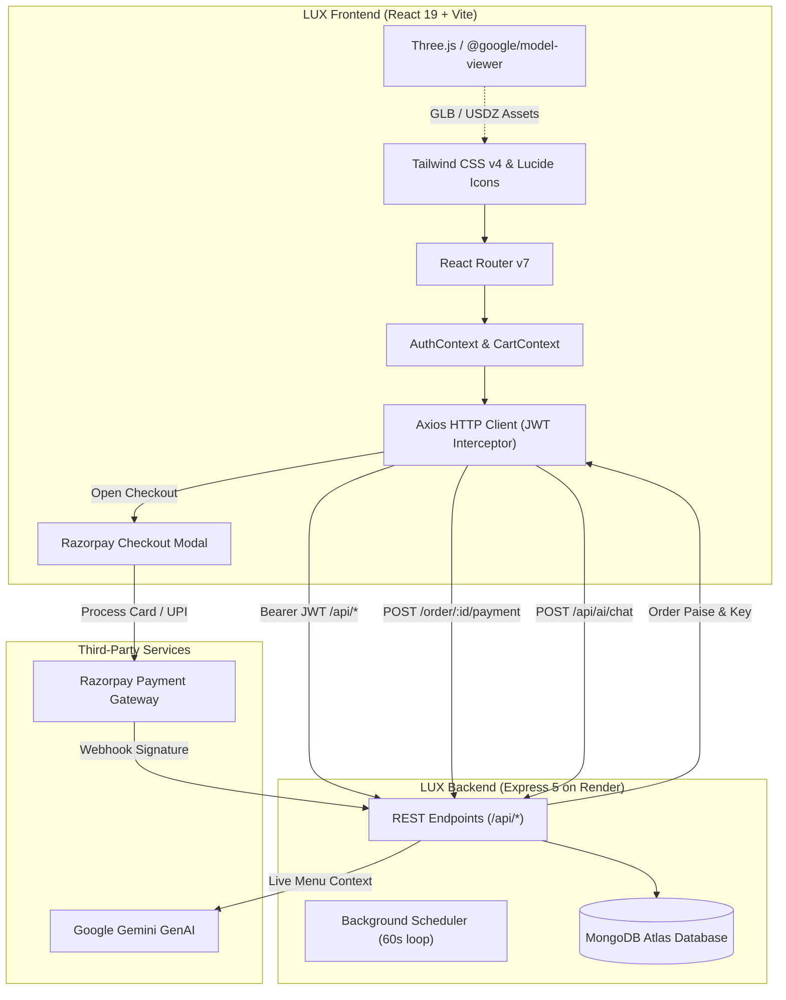

# <div align="center">🍽️ LUX RESTAURANT</div>

<div align="center">

**A Haute Cuisine Dining Experience & Real-Time Restaurant Management Suite**

[](https://luxrestaurant.vercel.app/)
[](https://lux-restaurant-backend.onrender.com)
[](https://github.com/Sourav142005/LUX-Restaurant-Backend)

<br/>

[](https://react.dev/)
[](https://vitejs.dev/)
[](https://tailwindcss.com/)
[](https://threejs.org/)
[](package.json)

</div>

---

## 📖 Executive Overview

**LUX Restaurant** is an end-to-end luxury dining and restaurant operations platform. Engineered as a high-performance Single Page Application (SPA), it couples an immersive culinary showcase for patrons with an administrative control suite for restaurant staff.

The application bridges digital ordering and floor service by delivering interactive **3D Food Exploration & WebAR**, dynamic multi-channel order orchestration (**Dine-In, Takeaway, Delivery**), flexible payment policies (**Instant Razorpay PayNow** and **In-Venue Pay-After-Dining**), automated table reservation scheduling, real-time table QR-code generation, and a context-aware voice-enabled **LUX AI Dining Concierge**.

---

## 📑 Table of Contents

- [Executive Overview](#-executive-overview)
- [System Architecture & Data Flow](#-system-architecture--data-flow)
- [Verified Feature Highlights](#-verified-feature-highlights)
  - [Customer Experience](#1-customer-experience)
  - [3D Food Visualization & WebAR](#2-3d-food-visualization--webar)
  - [LUX AI Dining Concierge](#3-lux-ai-dining-concierge)
  - [Admin Operations Suite](#4-admin-operations-suite)
- [Technology Stack](#-technology-stack)
- [Repository Structure](#-repository-structure)
- [Getting Started](#-getting-started)
  - [Prerequisites](#prerequisites)
  - [Installation](#installation)
  - [Environment Configuration](#environment-configuration)
  - [Available Scripts](#available-scripts)
- [Production Deployment (Vercel)](#-production-deployment-vercel)
- [Troubleshooting & FAQs](#-troubleshooting--faqs)
- [Cross-Repository Ecosystem](#-cross-repository-ecosystem)
- [Author & Acknowledgments](#-author--acknowledgments)

---

## 🏛️ System Architecture & Data Flow



---

## ✨ Verified Feature Highlights

### 1. Customer Experience

- **Gourmet Digital Menu:** Real-time catalog with dynamic category filters, search, dietary indicators (Vegetarian / Non-Vegetarian tags), spice levels, prep times, and live item availability.
- **Adaptive Dining Modes:**
  - **Dine-In:** Pre-order meals tied to future reservations, or link directly to a physical table on-site via walk-in QR codes (`?tableId=...`).
  - **Takeaway:** Pick-up scheduling without table constraints.
  - **Delivery:** Direct-to-door fulfillment with address capture.
- **Flexible Payment Policies:**
  - **PayNow:** Online transactions processed via the integrated Razorpay modal (Cards, UPI, Netbanking).
  - **PayAfterDining:** In-venue settlement for verified dine-in and table-seated guests.
- **Table Reservation Hub:** Interactive date, time, and party-size booking with instant conflict checks, personal reservation histories, and self-service cancellation.
- **Order Tracking & Safety:** Real-time order progress timeline (`Scheduled` ➔ `Pending` ➔ `Preparing` ➔ `Ready` ➔ `Delivered` / `Cancelled`) with safe order cancellation.
- **Resilient Authentication:** Email/password and phone-based OTP verification, forgot-password recovery via signed reset tokens, and automatic 401 session expiry recovery (`lux:auth-expired`).

### 2. 3D Food Visualization & WebAR

- **Interactive 3D Dish Viewers:** Embedded Model Viewer (`@google/model-viewer`) and Three.js canvas (`@react-three/fiber`, `@react-three/drei`) allowing 360-degree rotation, zoom, and inspection of signature menu items.
- **Augmented Reality Previews:** Augmented reality rendering using standard AR markers (`@ar-js-org/ar.js`) and direct USDZ/GLB placement on compatible iOS QuickLook and Android SceneViewer devices.
- **Dedicated Diagnostic Sandboxes:** Built-in route sandboxes (`/food-3d-test`, `/ar-test`, `/marker-ar-test`) for 3D model testing and rendering validation.

### 3. LUX AI Dining Concierge

- **Astra / Luci AI Assistant:** Floating, voice-enabled assistant available across all customer routes.
- **Speech Recognition & Synthesis:** Web Speech API integration for hands-free voice input and verbal feedback.
- **Live Menu Intelligence:** Grounded directly in live menu database records to provide accurate recommendations, dietary answers, and price quotes.
- **Actionable Responses:** Capable of directly dispatching items to the customer's cart through structured conversational payloads (`itemsToCart`).

### 4. Admin Operations Suite

- **Executive Analytics Dashboard:**
  - Real-time KPI summaries: Gross Revenue, Total Orders, Active Customers, and Pending Kitchen Tickets.
  - Interactive financial trends powered by **Recharts**.
  - Dynamic table availability gauges and today's reservation tracker.
  - Configurable auto-polling (30s) and manual sync controls with smooth background refresh.
- **Kitchen & Order Management (`/admin/orders`):**
  - Segmented order boards: Scheduled, Pending, Preparing, Ready, Delivered, and Cancelled.
  - **Dedicated Cancellation Modal:** Reason-validated cancellations routing directly to the backend's Phase 2A safe refund pipeline.
  - **Reconciliation Audit Center:** Filter orders requiring manual review (`reconciliationRequired`) with dedicated liability badges.
- **Floor & Table Management (`/admin/tables`):**
  - Table registry (capacity, location type, status).
  - Dynamic **QR Code Generation** (`qrcode.react`) for physical table placement to drive walk-in self-ordering.
  - Safe **Close Table** release controls with payment completion safeguards.
- **Menu & Category Control:** Full CRUD interface for menu items, pricing, preparation intervals, 3D model links, image paths, and category organization.
- **Reservation Oversight:** Administrative confirmation, rescheduling, and cancellation of table bookings.
- **User Oversight:** Customer account directory and permission audits.

---

## 🛠️ Technology Stack

| Domain | Technology | Purpose |
| :--- | :--- | :--- |
| **Framework** | [React 19](https://react.dev/) | Declarative component UI architecture |
| **Build Tool** | [Vite 8](https://vitejs.dev/) | Instant HMR development server and optimized Rollup bundler |
| **Routing** | [React Router v7](https://reactrouter.com/) | Client-side routing, protected customer & admin route guards |
| **Styling** | [Tailwind CSS v4](https://tailwindcss.com/) | High-performance utility-first styling with native CSS nesting |
| **3D & WebAR** | [Three.js](https://threejs.org/) & [@google/model-viewer](https://modelviewer.dev/) | 3D food model rendering, camera controls, and mobile AR |
| **3D React Fiber** | [@react-three/fiber](https://r3f.docs.pmnd.rs/) & [drei](https://github.com/pmndrs/drei) | Declarative Three.js scene graph in React |
| **WebAR Engine** | [@ar-js-org/ar.js](https://ar-js-org.github.io/AR.js-Docs/) | Pattern-marker AR camera view for table-top visualization |
| **HTTP Client** | [Axios](https://axios-http.com/) | Promise-based API requests with automatic JWT injection |
| **Data Viz** | [Recharts](https://recharts.org/) | Responsive SVG charts for revenue and order analytics |
| **QR Generation** | [qrcode.react](https://github.com/zpao/qrcode.react) | SVG and canvas QR code rendering for walk-in table ordering |
| **Icons & UI** | [Lucide React](https://lucide.dev/) & [React Icons](https://react-icons.github.io/react-icons/) | Feather & luxury icon sets |
| **Notifications** | [React Hot Toast](https://react-hot-toast.com/) | Lightweight toast notifications with branded styling |
| **Linter** | [Oxlint](https://oxc.rs/) | High-speed Rust-based JavaScript/React linter |

---

## 📂 Repository Structure

```text
frontend/
├── public/                     # Static assets served at root
│   ├── ar-data/                # Augmented reality descriptors & patterns
│   ├── images/                 # Dish photography & culinary assets
│   ├── markers/                # Hi-contrast camera tracking markers
│   ├── models/                 # GLB & USDZ 3D food models
│   ├── favicon.svg             # LUX brand favicon
│   └── icons.svg               # SVG sprite sheet
├── src/
│   ├── components/             # Reusable modular UI components
│   │   ├── AdminRoute/         # Role-based route guard for administrators
│   │   ├── AdminSidebar/       # Collapsible navigation drawer for admin pages
│   │   ├── FoodModelViewer/    # Three.js / @google/model-viewer canvas wrapper
│   │   ├── Footer/             # Brand footer with operating hours & contact
│   │   ├── LuxAi/              # Voice assistant, message formatter, Luci avatar
│   │   ├── MenuCard/           # Menu item card with pricing & 3D triggers
│   │   ├── Navbar/             # Customer navigation, cart counter, auth status
│   │   ├── OrderCard/          # Order summary card with tracking timeline
│   │   └── ProtectedRoute/     # Authentication guard for customer accounts
│   ├── context/                # Global state management
│   │   ├── AuthContext.jsx     # User authentication, token lifecycle, profile state
│   │   └── CartContext.jsx     # Cart items, quantities, totals, table sync
│   ├── Layouts/                # Page shell layouts
│   │   ├── AdminLayout.jsx     # Admin wrapper with responsive sidebar
│   │   └── CustomerLayout.jsx  # Customer wrapper with Navbar, Footer & LUX AI
│   ├── pages/                  # Routed application views
│   │   ├── Admin/              # Admin control suite
│   │   │   ├── Categories/     # Category CRUD & dish association
│   │   │   ├── Dashboard/      # Operations overview, Recharts analytics, KPI cards
│   │   │   ├── Menu/           # Food catalog management & 3D asset linking
│   │   │   ├── Orders/         # Order dispatching, cancellations, reconciliation
│   │   │   ├── Reservations/   # Table booking approvals & schedules
│   │   │   ├── Tables/         # Floor plan status & table QR generator
│   │   │   └── Users/          # User management directory
│   │   ├── AR/                 # Augmented reality viewports (MarkerAR.jsx)
│   │   ├── Auth/               # ForgotPassword, ResetPassword, VerifyPhone
│   │   ├── Cart/               # Order review, dining mode selector, pricing
│   │   ├── Checkout/           # Razorpay integration, table selection, PayAfterDining
│   │   ├── Home/               # Hero showcase, signature carousel, reservation CTA
│   │   ├── Login/              # Multi-identifier sign-in
│   │   ├── Menu/               # Full digital culinary catalog with filters
│   │   ├── Orders/             # Customer personal order tracker
│   │   ├── Register/           # New account registration & phone verification
│   │   ├── Reservations/       # Booking scheduler & MyReservations overview
│   │   ├── ARTest.jsx          # AR diagnostic sandbox
│   │   └── Food3DTest.jsx      # 3D diagnostic sandbox
│   ├── services/
│   │   └── api.js              # Centralized Axios instance with auth interceptors
│   ├── App.jsx                 # Client-side router declarations
│   ├── index.css               # Global styling & Tailwind CSS v4 directives
│   └── main.jsx                # Application root mount
├── .env.local                  # Local environment overrides (ignored by git)
├── index.html                  # HTML5 document template
├── package.json                # Project dependencies and script declarations
├── vite.config.js              # Vite compiler configuration
└── README.md                   # Repository documentation
```

---

## 🚀 Getting Started

### Prerequisites

- **Node.js:** `v18.0.0` or higher (`v20.x` or `v22.x` recommended)
- **Package Manager:** `npm` (`v9.x` or higher)
- **Backend API:** A running instance of the [LUX Backend](https://github.com/Sourav142005/LUX-Restaurant-Backend) (either local or deployed on Render)

### Installation

1. **Clone the repository:**
   ```bash
   git clone https://github.com/Sourav142005/LUX-Restaurant-Frontend.git
   cd LUX-Restaurant-Frontend
   ```

2. **Install dependencies:**
   ```bash
   npm install
   ```

### Environment Configuration

The application consumes `VITE_API_URL` to route requests through Axios. Create a local environment file in the `frontend` root:

```bash
# Windows PowerShell
New-Item -ItemType File -Name .env.local -Force
```

Add your backend API target (ensure no trailing slash):

```dotenv
# .env.local - Local Development Configuration
VITE_API_URL=http://localhost:5000/api

# For testing directly against the deployed Render backend:
# VITE_API_URL=https://lux-restaurant-backend.onrender.com/api
```

> [!IMPORTANT]
> Variables prefixed with `VITE_` are bundled directly into client JavaScript. Never place private keys, database passwords, or server-side payment secrets in frontend environment files.

### Available Scripts

| Command | Action |
| :--- | :--- |
| `npm run dev` | Boots the Vite development server with Hot Module Replacement (HMR) at `http://localhost:5173` |
| `npm run build` | Compiles an optimized, minified production distribution to `dist/` |
| `npm run preview` | Runs a local static web server to preview the built `dist/` bundle |
| `npm run lint` | Executes [Oxlint](https://oxc.rs/) across all JavaScript/JSX source files |

---

## ☁️ Production Deployment (Vercel)

The LUX Frontend is configured for zero-configuration continuous deployment on [Vercel](https://vercel.app).

1. **Import Project:** Connect your GitHub account and import `Sourav142005/LUX-Restaurant-Frontend`.
2. **Framework Preset:** Select **Vite**.
3. **Build Settings:**
   - **Build Command:** `npm run build` (or `vite build`)
   - **Output Directory:** `dist`
   - **Install Command:** `npm install`
4. **Environment Variables:**
   - Add `VITE_API_URL` with value: `https://lux-restaurant-backend.onrender.com/api`
5. **SPA Routing:** Ensure single-page routing rewrites are configured so all sub-routes resolve to `index.html`.

Live Production URL: **[https://luxrestaurant.vercel.app/](https://luxrestaurant.vercel.app/)**

---

## 🔧 Troubleshooting & FAQs

<details>
<summary><b>1. Network Error or CORS Blocked when communicating with Backend</b></summary>

- **Symptom:** Browser console logs `Access to XMLHttpRequest at '...' from origin 'http://localhost:5173' has been blocked by CORS policy`.
- **Solution:** Verify that your backend `CLIENT_URL` environment variable includes your local frontend origin (e.g. `http://localhost:5173`). In production, the backend allows any `*.vercel.app` domain automatically.
</details>

<details>
<summary><b>2. Razorpay Modal Does Not Open on Checkout</b></summary>

- **Symptom:** Clicking "Proceed to Payment" displays a loading state or logs `Razorpay SDK failed to load`.
- **Solution:** Verify your internet connection allows loading scripts from `https://checkout.razorpay.com/v1/checkout.js`. Ensure your browser ad-blocker or brave shields are not blocking payment iframes. Check that the backend returned a valid `key` in the `POST /order/:id/payment` response.
</details>

<details>
<summary><b>3. Session Expiration / Immediate 401 Redirects</b></summary>

- **Symptom:** User is abruptly logged out with a toast notification: *"Your session has expired. Please sign in again."*
- **Solution:** The frontend features an automatic 401 interceptor in [`src/services/api.js`](src/services/api.js). When a JWT expires, the app clears stale localStorage tokens and dispatches `lux:auth-expired`. Simply log in again to acquire a fresh 24-hour token.
</details>

---

## 🌐 Cross-Repository Ecosystem

| Component | Repository Link | Deployed URL |
| :--- | :--- | :--- |
| **Frontend Web App** | [Sourav142005/LUX-Restaurant-Frontend](https://github.com/Sourav142005/LUX-Restaurant-Frontend) | [luxrestaurant.vercel.app](https://luxrestaurant.vercel.app/) |
| **Backend REST API** | [Sourav142005/LUX-Restaurant-Backend](https://github.com/Sourav142005/LUX-Restaurant-Backend) | [lux-restaurant-backend.onrender.com](https://lux-restaurant-backend.onrender.com) |

---

## 👨‍💻 Author & Acknowledgments

**Sourav Shridhar Kamble**<br/>
- **GitHub:** [@Sourav142005](https://github.com/Sourav142005)
- **LinkedIn:** [Sourav Kamble](https://www.linkedin.com/in/sourav-kamble)
- **Email:** [sourav142005@gmail.com](mailto:sourav142005@gmail.com)

---

<div align="center">
<sub>Crafted with passion for haute cuisine and modern web engineering. &copy; 2026 LUX Restaurant Platform.</sub>
</div>
