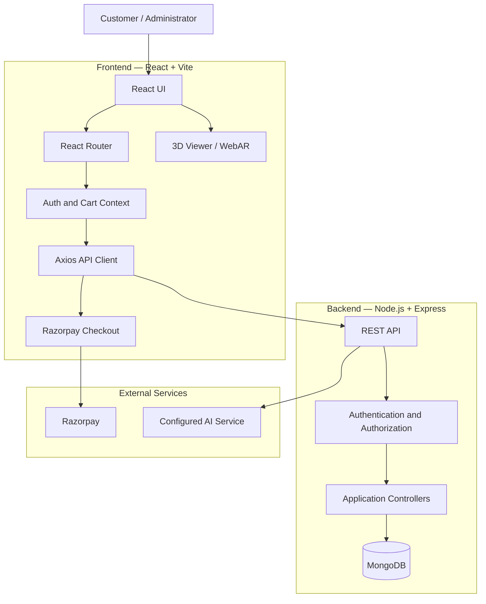

 <div align="center">

# 🍽️ LUX RESTAURANT

### A Modern Dining Experience & Restaurant Management Platform

A full-stack restaurant platform combining digital ordering, reservations, payments, 3D food visualization, WebAR, and restaurant administration.

[](https://luxrestaurant.vercel.app/)
[](https://lux-restaurant-backend.onrender.com)
[](https://github.com/Sourav142005/LUX-Restaurant-Frontend)

[](https://react.dev/)
[](https://vite.dev/)
[](https://tailwindcss.com/)
[](https://threejs.org/)
[](package.json)

</div>

---

## Overview

**LUX Restaurant** is a full-stack restaurant platform designed to improve the dining experience for customers and simplify restaurant operations for administrators.

The customer-facing application provides a digital menu, multiple ordering modes, table reservations, order tracking, online payment, dish reviews, saved regular orders, and 3D/AR food previews. The administration interface provides tools for managing menus, orders, reservations, tables, customers, and restaurant performance.

The platform is built with a React frontend and a Node.js/Express backend connected to MongoDB. It integrates Razorpay for online payments and provides an AI dining assistant that can use menu information to help customers explore dishes.

**Live application:** https://luxrestaurant.vercel.app/  
**Backend API:** https://lux-restaurant-backend.onrender.com

## Table of Contents

- [Features](#features)
  - [Customer Experience](#customer-experience)
  - [Ordering and Payments](#ordering-and-payments)
  - [Customer Engagement](#customer-engagement)
  - [3D Food Visualization and AR](#3d-food-visualization-and-ar)
  - [AI Dining Assistant](#ai-dining-assistant)
  - [Administration](#administration)
- [System Architecture](#system-architecture)
- [Technology Stack](#technology-stack)
- [Repository Structure](#repository-structure)
- [Getting Started](#getting-started)
- [Environment Configuration](#environment-configuration)
- [Available Scripts](#available-scripts)
- [Deployment](#deployment)
- [Troubleshooting](#troubleshooting)
- [Related Repository](#related-repository)
- [Author](#author)

## Features

### Customer Experience

- **Digital Menu:** Browse menu items with categories, search, availability information, dietary labels, preparation details, and pricing.
- **Dining Modes:** Supports dine-in, takeaway, and delivery ordering flows.
- **Table Reservations:** Select a date, time, and party size; view and manage personal reservations.
- **Order Tracking:** View order status and order history.
- **Authentication:** Customer registration and login, phone verification, and password recovery flows.
- **Responsive Interface:** Customer pages are designed to work across desktop and mobile screen sizes.

### Ordering and Payments

- **Cart Management:** Add dishes, adjust quantities, and review an order before checkout.
- **Online Payment:** Razorpay checkout integration for supported online payment methods.
- **Pay After Dining:** Supports the configured in-venue payment flow for eligible dine-in orders.
- **Order Management:** Orders can be followed through their lifecycle, with cancellation and payment safeguards enforced by the backend.
- **Table QR Ordering:** Table QR codes can open the menu with table context for on-premises ordering.

### Customer Engagement

- **Most Ordered Dishes:** Highlights popular dishes using recent eligible order history. Popularity is calculated using ordered quantities, not just the number of orders.
- **Ratings and Reviews:** Eligible customers can submit a 1–5 star rating and an optional comment for dishes they have purchased. Customers can manage their own reviews.
- **Seasonal Specials:** Displays menu items that administrators have marked as seasonal specials and that are currently within their configured availability period.
- **My Regular Orders:** Customers can create private collections of frequently ordered dishes, organize quantities, and add available collection items to the cart for a quicker reorder. Current menu prices and availability are checked when preparing a reorder.

### 3D Food Visualization and AR

- **3D Dish Viewer:** View supported food models in an interactive 3D viewer.
- **Markerless AR:** Uses `<model-viewer>` and supported device/browser AR capabilities to place compatible 3D models in the user's environment.
- **Marker-Based AR:** Provides a separate AR.js and Three.js experience that uses a Hiro pattern marker.
- **Model Assets:** 3D models are provided through supported GLB/GLTF or USDZ assets, depending on the viewer and device.

AR availability depends on the device, browser, operating system, model format, camera permissions, and secure-context requirements. Diagnostic routes are intended for testing and should not be treated as guaranteed support on every device.

### AI Dining Assistant

- **Conversational Help:** Provides a voice-enabled assistant in the customer interface.
- **Speech Input and Output:** Uses browser speech capabilities where supported.
- **Menu-Aware Responses:** The backend can provide menu context to the AI service for dish-related questions and recommendations.
- **Cart Actions:** Supported assistant responses can include structured dish selections for adding items to the cart.

AI responses and speech features depend on the configured service credentials and browser support.

### Administration

- **Dashboard:** Displays operational summaries and visual reports for restaurant activity.
- **Menu Management:** Create and update menu items, categories, pricing, availability, and supported media/model references.
- **Order Management:** Review incoming orders and update their operational status.
- **Reservations:** View and manage customer table reservations.
- **Table Management:** Maintain table information and generate QR codes for table-based ordering.
- **Customer Management:** View customer accounts and relevant account information.
- **Seasonal Specials Management:** Mark menu items as seasonal specials and configure their start and end dates.

Administrative actions are protected by backend authentication and role-based authorization.

## System Architecture

LUX uses a client-server architecture. The frontend communicates with the backend through REST API requests. The backend handles authentication, business rules, database operations, payment-related workflows, and integrations with external services.



## Technology Stack

| Area | Technology | Purpose |
|---|---|---|
| Frontend framework | React 19 | Component-based user interface |
| Build tool | Vite | Development server and production build |
| Routing | React Router | Client-side navigation and route protection |
| Styling | Tailwind CSS 4 | Utility-first styling |
| HTTP client | Axios | Frontend-to-backend API communication |
| Backend | Node.js and Express | REST API and application logic |
| Database | MongoDB with Mongoose | Persistent application data |
| Authentication | JWT and role-based middleware | Authenticated and authorized access |
| Payments | Razorpay | Online payment checkout |
| 3D rendering | Three.js and model-viewer | Interactive 3D food models |
| Marker-based AR | AR.js | Pattern-marker tracking |
| Charts | Recharts | Dashboard data visualization |
| QR codes | qrcode.react | Table QR code generation |
| Icons | Lucide React and React Icons | Interface iconography |
| Notifications | React Hot Toast | User feedback and notifications |
| Linting | Oxlint | JavaScript and JSX linting |

## Repository Structure

The following is a high-level overview of the frontend repository. Some implementation details may evolve as the project changes.

```text
LUX-Restaurant-Frontend/
├── public/
│   ├── ar-data/
│   ├── images/
│   ├── markers/
│   └── models/
├── src/
│   ├── components/
│   │   ├── AdminRoute/
│   │   ├── FoodModelViewer/
│   │   ├── LuxAi/
│   │   ├── MenuCard/
│   │   ├── Navbar/
│   │   ├── OrderCard/
│   │   ├── RegularOrders/
│   │   ├── Reviews/
│   │   └── ProtectedRoute/
│   ├── context/
│   │   ├── AuthContext.jsx
│   │   └── CartContext.jsx
│   ├── Layouts/
│   ├── pages/
│   │   ├── Admin/
│   │   ├── AR/
│   │   ├── Auth/
│   │   ├── Cart/
│   │   ├── Checkout/
│   │   ├── Home/
│   │   ├── Menu/
│   │   ├── Orders/
│   │   ├── RegularOrders/
│   │   └── Reservations/
│   ├── services/
│   │   └── api.js
│   ├── App.jsx
│   ├── index.css
│   └── main.jsx
├── .env.example
├── index.html
├── package.json
├── vite.config.js
└── README.md
```

## Getting Started

### Prerequisites

- Node.js version supported by the installed Vite release (Node.js 20.19+ or 22.12+ is recommended for Vite 8).
- npm.
- A running LUX backend instance, either locally or deployed.

### 1. Clone the repository

```bash
git clone https://github.com/Sourav142005/LUX-Restaurant-Frontend.git
cd LUX-Restaurant-Frontend
```

### 2. Install dependencies

```bash
npm install
```

### 3. Configure the frontend environment

Create a `.env.local` file in the frontend project root. See [Environment Configuration](#environment-configuration) below.

### 4. Start the development server

```bash
npm run dev
```

Vite normally serves the application at:

```text
http://localhost:5173
```

Make sure the backend is running and that its CORS configuration permits the frontend origin.

## Environment Configuration

The frontend uses the `VITE_API_URL` variable to determine the backend API base URL.

Create `.env.local` in the frontend root:

```dotenv
# Local backend
VITE_API_URL=http://localhost:5000/api
```

To use the deployed backend instead:

```dotenv
VITE_API_URL=https://lux-restaurant-backend.onrender.com/api
```

Use the value appropriate to your environment. Do not add both active definitions to the same file.

> **Security:** Vite exposes variables prefixed with `VITE_` to browser-side code. Never put database credentials, JWT secrets, Razorpay secret keys, private API keys, or other server-side secrets in frontend environment files.

The `.env.local` file is intended for local configuration and should not be committed. Use `.env.example` as the safe configuration template where available.

## Available Scripts

| Command | Description |
|---|---|
| `npm run dev` | Starts the Vite development server. |
| `npm run build` | Creates the optimized production build in `dist/`. |
| `npm run preview` | Serves the production build locally for preview. |
| `npm run lint` | Runs the configured Oxlint checks. |

Run scripts from the frontend repository root.

## Deployment

The frontend is deployed on **Vercel**.

- **Repository:** [LUX-Restaurant-Frontend](https://github.com/Sourav142005/LUX-Restaurant-Frontend)
- **Production URL:** https://luxrestaurant.vercel.app/

Typical Vercel configuration:

| Setting | Value |
|---|---|
| Framework preset | Vite |
| Install command | `npm install` |
| Build command | `npm run build` |
| Output directory | `dist` |
| Environment variable | `VITE_API_URL` |

Set `VITE_API_URL` in the Vercel project environment to:

```text
https://lux-restaurant-backend.onrender.com/api
```

If client-side routes are refreshed directly in production, configure the appropriate Vercel SPA rewrite so application routes are served through `index.html`.

The backend is deployed separately:

- **Backend repository:** [LUX-Restaurant-Backend](https://github.com/Sourav142005/LUX-Restaurant-Backend)
- **Backend URL:** https://lux-restaurant-backend.onrender.com

## Troubleshooting

### API requests fail or show a CORS error

- Confirm that the backend is running and reachable.
- Check that `VITE_API_URL` points to the correct API base URL.
- Confirm that the backend CORS allowlist includes the frontend origin, such as `http://localhost:5173`.
- Restart the Vite server after changing environment variables.

### Razorpay checkout does not open

- Confirm that the browser can load the Razorpay checkout script.
- Check the browser console and backend logs for the actual failure.
- Verify that the backend payment configuration is present and valid.
- Do not expose the Razorpay secret key in frontend configuration.

### Authentication stops working

- Check whether the session token has expired.
- Sign in again to obtain a valid session.
- Confirm that the frontend and backend are using compatible authentication configuration.
- Inspect the browser console and API response for the specific error.

### 3D model or AR preview does not work

- Confirm that the model URL is reachable and the model file is valid.
- Allow camera access when the selected AR mode requires it.
- Test on a supported mobile device and browser.
- For browser-based AR, use HTTPS or an eligible local development origin.
- Remember that marker-based AR requires the correct printed/displayed marker and camera visibility.

## Related Repository

| Component | Repository | Deployment |
|---|---|---|
| LUX Frontend | [LUX-Restaurant-Frontend](https://github.com/Sourav142005/LUX-Restaurant-Frontend) | [Live Website](https://luxrestaurant.vercel.app/) |
| LUX Backend | [LUX-Restaurant-Backend](https://github.com/Sourav142005/LUX-Restaurant-Backend) | [Backend API](https://lux-restaurant-backend.onrender.com) |

## Author

**Sourav Shridhar Kamble**

- GitHub: [@Sourav142005](https://github.com/Sourav142005)
- LinkedIn: [Sourav Kamble](https://www.linkedin.com/in/sourav-kamble)
- Email: [sourav142005@gmail.com](mailto:sourav142005@gmail.com)

---

<div align="center">

*Built with care at the intersection of hospitality and modern web engineering.*

© 2026 LUX Restaurant Platform

</div>